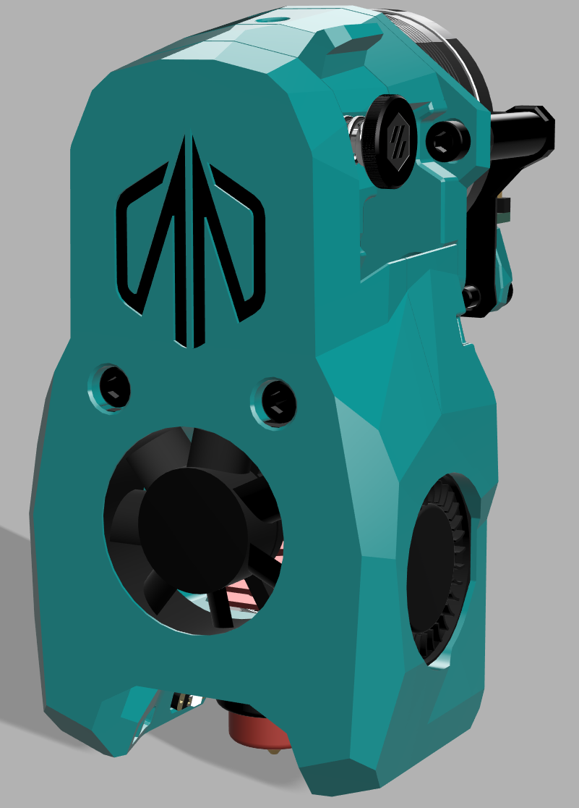

# Mini Stealthburner - MasturMods Edition

This is an aesthetic mod of Voron Design's Mini Stealthburner. Only the front cowling is modified and the rest of the parts needed to assemble the toolhead can be found in the [Voron V0](https://github.com/VoronDesign/Voron-0/tree/Voron0.2r1/STLs/Toolheads/Mini_Stealthburner) repo.

There are two parts needed for this front cowling. First, print the insert out of your primary color. After you have that part ready slice the main body and insert a filament change or pause command at layer 16 (assuming traditional Voron print standards). When the print for the main body pauses, drop the insert into the formed gap in the part. This allows for a recessed logo with some flare!